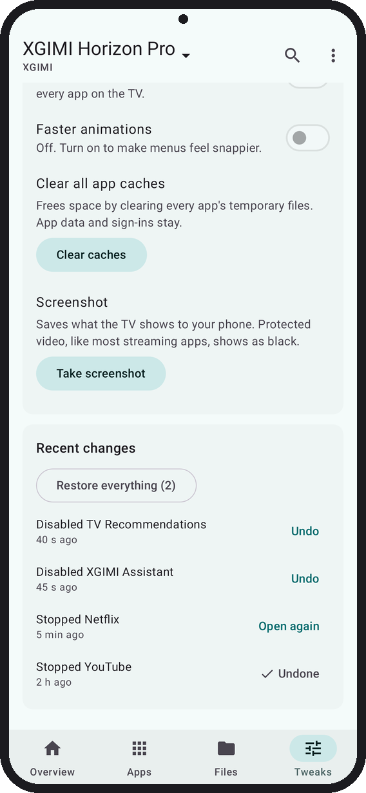
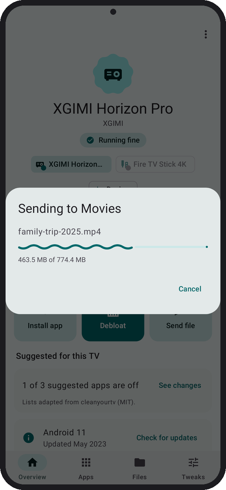
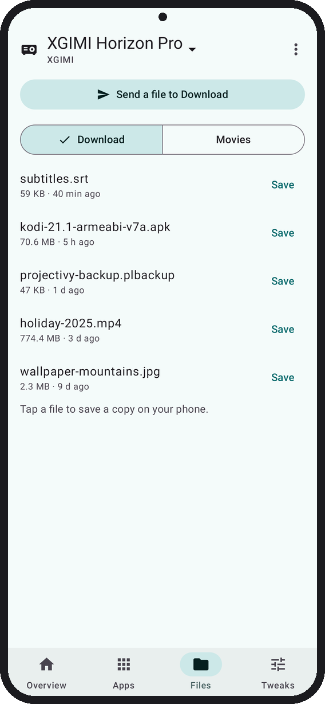

#  Tellyscope

Debloat your Android TV, install apps, and browse and transfer files on it, all from your phone. No root, no PC.

<p>
  
  
  
  
  <a href="../../releases/latest"></a>
</p>

<a href="../../releases/latest"></a>

Or get updates automatically with [Obtainium](#get-it).


<sub>Before and after on a Redmi TV, from [cleanyourtv](https://github.com/Gathin23/cleanyourtv), whose debloat lists Tellyscope uses. Their after also shows their own launcher.</sub>

<table>
  <tr>
    <td width="25%"></td>
    <td width="25%"></td>
    <td width="25%"></td>
    <td width="25%"></td>
  </tr>
  <tr>
    <td align="center"><sub>Your TV at a glance</sub></td>
    <td align="center"><sub>Review every app Debloat turns off</sub></td>
    <td align="center"><sub>It names each app before it acts</sub></td>
    <td align="center"><sub>Undo anything from History</sub></td>
  </tr>
  <tr>
    <td></td>
    <td></td>
    <td></td>
  </tr>
  <tr>
    <td align="center"><sub>Install or update apps</sub></td>
    <td align="center"><sub>Send files to the TV</sub></td>
    <td align="center"><sub>Browse and save the TV's files</sub></td>
  </tr>
</table>

<sub>Rendered from the app's screenshot tests with sample data.</sub>

## Get it

- **GitHub Releases.** Download `Tellyscope-<version>.apk` from the [Releases](../../releases) page and open it on your phone. You may need to allow installs from your browser or file manager first. Pre-releases marked `-alpha` are test builds: they install as a separate app next to the regular one, with the same name and icon.
- **Obtainium.** To get updates automatically, add this repository's GitHub address in [Obtainium](https://github.com/ImranR98/Obtainium). Turn on **Include prereleases** only if you want the alpha builds.

Tellyscope needs a phone on Android 8.0 or newer, on the same Wi-Fi as the TV, and a TV with developer options turned on ([how](#setting-up-your-tv)).

## Is it safe?

- **Small and private.** Under 3 MB. No ads, no tracking, no accounts. Its only internet request fetches the debloat lists from this project's GitHub, or from your own fork if you point it there; everything else stays on your Wi-Fi.
- **Reversible.** Tellyscope disables apps; it never uninstalls them, so nothing is deleted. Every change goes into History with an Undo, and **Restore everything** turns back on all it turned off.
- **Protected list.** Apps the TV needs to start, update, stay on Wi-Fi, show its home screen or take input can't be stopped or disabled. There is no override.
- **You see it first.** Debloat shows every app it will turn off, and the confirm names each one before anything runs.

The full rules are under [Safety rules](#safety-rules).

## What it does

Tellyscope is a phone app that talks to your Android TV, Google TV or Fire TV over the network using ADB, the same debugging protocol developers use.

- **Find and connect.** It looks for TVs on your Wi-Fi, or you add one by IP address. Classic network debugging (port 5555) and Android 11+ wireless debugging with a 6-digit pairing code both work. A step-by-step card shows how to turn debugging on for Google TV, Android TV, Fire TV, Xiaomi and XGIMI.
- **Remembers your TVs.** They reconnect on their own after a restart of the app or the TV. You can rename a TV (the name stays on your phone) or forget it.
- **How it's doing.** The TV at a glance: maker and model, a one-line summary such as "Running fine" or "Storage almost full", its address, how long it's been on, its Android version and when its software was last updated. Below that, free space as a bar, then CPU, RAM, temperature and network speed.
- **The main jobs up front.** Big **Install app**, **Debloat** and **Send file** buttons right under the vitals.
- **Advanced.** Every number in one place: memory, storage, CPU, temperature, uptime and screen state, CPU and RAM by app, processes, network and data used, and the TV's address.
- **Apps.** Every app on the TV with its real name and icon. Stop, disable or turn back on any app that isn't protected; each button says what it will do and asks first.
- **Another home screen.** With a second launcher such as Projectivy installed, its row in Apps offers **Make it your home screen**. Tellyscope makes it Home, checks that Home really opens it, and only then disables the old launcher, so the TV can't switch back by itself. One Undo in History turns the old launcher back on and makes it Home again. On Google TV, the Apps row and the Live tab are part of the old launcher and go with it.
- **Debloat.** Tellyscope matches your TV to a tested clean-up list (adapted from [cleanyourtv](https://github.com/Gathin23/cleanyourtv)) and says how many of its apps are still on. **Debloat** first asks which TV it is, with the match already chosen, then shows every app it will turn off. Apps are pre-ticked only when the TV runs the Android version the list was tested on; untick anything you use, and you confirm before anything is disabled. If you'd rather not trust our lists, point the app at your own fork of them in Settings (see [CONTRIBUTING](CONTRIBUTING.md#using-your-own-lists)).
- **History.** Every change is listed with an Undo, and **Restore everything** turns back on what Tellyscope turned off. Undoing a **Turn on** asks first, since it disables the app again. History is kept per TV, across restarts.
- **Install apps.** Pick an APK, several split APKs or an `.apks`/`.xapk`/`.apkm` bundle on your phone. Before installing, Tellyscope shows the app's name, version and size and says whether it's new, an update, a reinstall or an older version. It won't install an older version over a newer one unless you tick the box. If the TV refuses, you get the reason in plain words.
- **Files.** Send a file from your phone into the TV's Download or Movies folder, or save one from there to your phone. A file with the same name gets a " (1)" instead of being overwritten, and a cancelled copy leaves nothing half-written behind.

## Setting up your TV

1. On the TV, open **About** in Settings and press OK on **Build** (Fire TV: your device's name) 7 times, until it says you're a developer.
2. In **Developer options**, turn on **USB debugging** (Fire TV: **ADB debugging**), and **Network debugging** if your TV lists it. Newer TVs may show **Wireless debugging** instead; turn that on too.
3. Put your phone on the same Wi-Fi as the TV and open Tellyscope. Tap **Connect** next to your TV.
4. The TV asks "Allow USB debugging?". Tick **Always allow from this computer**, then press **Allow**. With wireless debugging, Tellyscope asks for the 6-digit pairing code the TV shows instead.

The menu paths differ by brand; the app shows the exact steps for yours.

## Safety rules

Debloating a TV can break it if done carelessly. Tellyscope is built around these rules, and contributions must keep them:

1. **Disable only, never uninstall.** Tellyscope uses `pm disable-user`, which is reversible from the app or with `pm enable`. It never runs `pm uninstall`, not even for the current user.
2. **Record before changing.** Before the first change on a TV, Tellyscope notes which apps were already off, so **Restore everything** turns back on only what Tellyscope turned off. Every change goes into the TV's history with an Undo. The history lives on the phone and is deleted if you uninstall Tellyscope; a disabled app still shows in the Apps list with **Turn on**.
3. **Protected list.** Packages the TV needs to boot, install its updates, stay on Wi-Fi, show web pages, show the home screen or accept input are on a protected list. Tellyscope refuses to stop or disable them, and there is no override in the app. If the TV doesn't say which app is its home screen, Tellyscope refuses to stop or disable anything. The one exception is switching home screens: the old launcher is disabled only after another launcher has become Home and Home has been checked to open it, and the current home screen itself never can be. A TV's suggested list can protect more apps, never fewer.
4. **No root, no exploits.** Only what ADB allows on a stock TV.
5. **Nothing left on the TV.** To show real app names and icons, Tellyscope copies a small helper to `/data/local/tmp`, runs it once and deletes it. The helper only reads through PackageManager: no writes, no permissions, no network.

## Project layout

| Module | What it is |
|---|---|
| `:app` | The Android phone app. Kotlin, Jetpack Compose, Material 3 Expressive. Package `app.tellyscope`. |
| `:adb` | Pure Kotlin/JVM library on top of [Kadb](https://github.com/flyfishxu/Kadb): connecting, pairing and running commands on a TV. Unit-testable without a device. |
| `app/src/helper` | The label helper: plain Java, built into a dex in the app's assets and run on the TV with `app_process`. |
| `:cli` | Desktop smoke test for `:adb` against a real TV (`./gradlew :cli:run --args="stats <tv-ip>"`). Not shipped. |

## Building

Requirements:

- **JDK 25.** Kadb ships Java 25 bytecode, so `:adb` tests need a Java 25 runtime. `:adb` itself still compiles to Java 17 bytecode so the app can use it.
- **Android SDK** with platform 37. Set `ANDROID_HOME` or put `sdk.dir=...` in `local.properties`.

```sh
./gradlew build          # assemble, unit tests and lint
./gradlew :app:installDebug
```

The app supports phones on Android 8.0 (API 26) and newer.

## Contributing

See [CONTRIBUTING.md](CONTRIBUTING.md). If you have an Android TV, a [device report](../../issues/new?template=device_report.yml) helps even if nothing worked.

## License

Tellyscope is licensed under the [GNU General Public License v3.0](LICENSE). Third-party credits are in [NOTICE](NOTICE).
