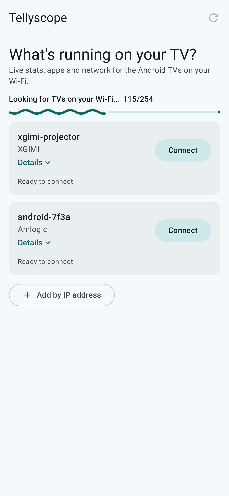
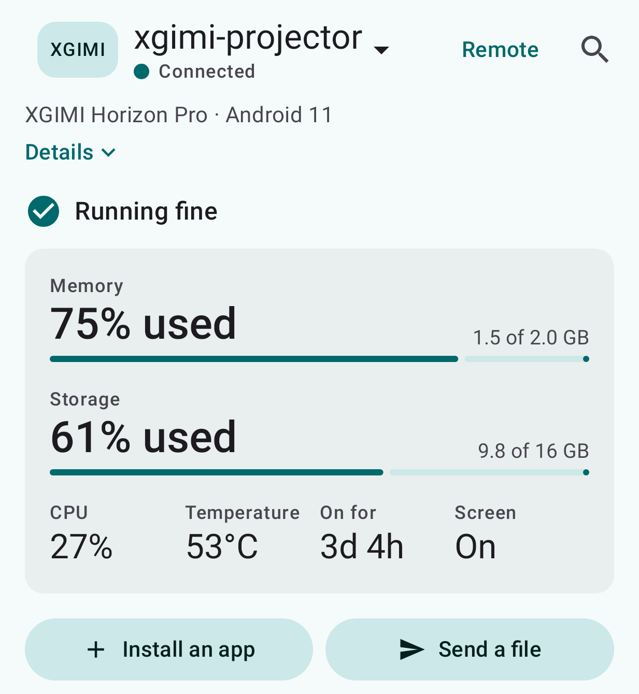
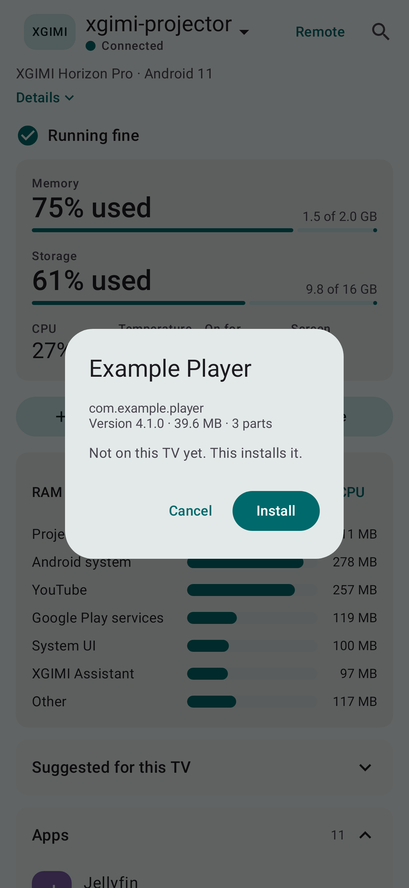
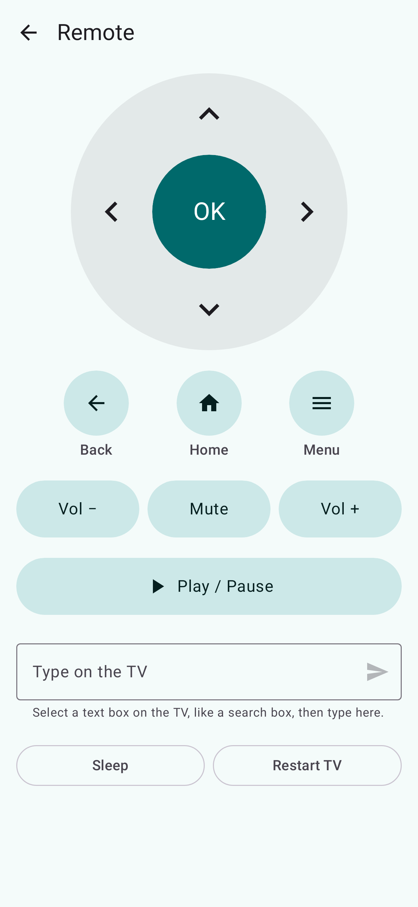

# Tellyscope

See inside your Android TV from your phone. Live stats, reversible debloat, app installs, file copies and a remote, all over Wi-Fi ADB. No root, no PC.

> **Status: alpha.** Tellyscope connects to real TVs and makes real changes, but it has only been tried on a few models. Expect rough edges, and keep the TV's own remote nearby.

<p>
  
  
  
  
</p>

<sub>Rendered from the app's screenshot tests with sample data.</sub>

## What it does

Tellyscope is a phone app that talks to your Android TV, Google TV or Fire TV over the network using ADB, the same debugging protocol developers use.

- **Find and connect.** It looks for TVs on your Wi-Fi, or you add one by IP address. Classic network debugging (port 5555) and Android 11+ wireless debugging with a 6-digit pairing code both work. A step-by-step card shows how to turn debugging on for Google TV, Android TV, Fire TV, Xiaomi and XGIMI.
- **Remembers your TVs.** They reconnect on their own after a restart of the app or the TV. You can rename a TV (the name stays on your phone) or forget it.
- **Live stats.** Memory, storage, CPU, temperature and uptime, with a one-line summary such as "Running fine" or "Storage almost full".
- **Apps.** Every app on the TV with its real name and icon. Stop, disable, turn back on or open any app that isn't protected; each button says what it will do and asks first.
- **Suggested for this TV.** Tellyscope matches your TV to a tested clean-up list (adapted from [cleanyourtv](https://github.com/Gathin23/cleanyourtv)) and shows the apps on it that are still on. Pick your model if it isn't matched. Apps are pre-ticked only when the TV runs the Android version the list was tested on, and you confirm before anything is disabled.
- **History.** Every change is listed with an Undo, and **Restore everything** turns back on what Tellyscope turned off. History is kept per TV, across restarts.
- **Install apps.** Pick an APK, several split APKs or an `.apks`/`.xapk`/`.apkm` bundle on your phone. Before installing, Tellyscope shows the app's name, version and size and says whether it's new, an update, a reinstall or an older version. It won't install an older version over a newer one unless you tick the box. If the TV refuses, you get the reason in plain words.
- **Files.** Send a file from your phone into the TV's Download or Movies folder, or save one from there to your phone. A file with the same name gets a " (1)" instead of being overwritten, and a cancelled copy leaves nothing half-written behind.
- **Remote.** D-pad and OK, Back, Home, Menu, volume and mute, Play / Pause and Sleep. Type into the TV's search boxes from your phone (plain letters, numbers and symbols, one line at a time). Restart the TV; Tellyscope reconnects when it's back.

## Setting up your TV

1. On the TV, open **About** in Settings and press OK on **Build** (Fire TV: your device's name) 7 times, until it says you're a developer.
2. In **Developer options**, turn on **USB debugging** (Fire TV: **ADB debugging**), and **Network debugging** if your TV lists it. Newer TVs may show **Wireless debugging** instead; turn that on too.
3. Put your phone on the same Wi-Fi as the TV and open Tellyscope. Tap **Connect** next to your TV.
4. The TV asks "Allow USB debugging?". Tick **Always allow from this computer**, then press **Allow**. With wireless debugging, Tellyscope asks for the 6-digit pairing code the TV shows instead.

The menu paths differ by brand; the app shows the exact steps for yours.

## Safety rules

Debloating a TV can break it if done carelessly. Tellyscope is built around these rules, and contributions must keep them:

1. **Disable only, never uninstall.** Tellyscope uses `pm disable-user`, which is reversible from the app or with `pm enable`. It never runs `pm uninstall`, not even for the current user.
2. **Record before changing.** Before the first change on a TV, Tellyscope notes which apps were already off, so **Restore everything** turns back on only what Tellyscope turned off. Every change goes into the TV's history with an Undo. The history lives on the phone and is deleted if you uninstall Tellyscope; a disabled app still shows in the Apps list with **Turn on**.
3. **Protected list.** Packages the TV needs to boot, update, show the home screen or accept input are on a protected list. Tellyscope refuses to stop or disable them, and there is no override in the app. If the TV doesn't say which app is its home screen, Tellyscope refuses to stop or disable anything. A TV's suggested list can protect more apps, never fewer.
4. **No root, no exploits.** Only what ADB allows on a stock TV.
5. **Nothing left on the TV.** To show real app names and icons, Tellyscope copies a small helper to `/data/local/tmp`, runs it once and deletes it. The helper only reads through PackageManager: no writes, no permissions, no network.

## Project layout

| Module | What it is |
|---|---|
| `:app` | The Android phone app. Kotlin, Jetpack Compose, Material 3 Expressive. Package `app.tellyscope`. |
| `:adb` | Pure Kotlin/JVM library on top of [Kadb](https://github.com/flyfishxu/Kadb): connecting, pairing and running commands on a TV. Unit-testable without a device. |
| `app/src/helper` | The label helper: plain Java, built into a dex in the app's assets and run on the TV with `app_process`. |
| `:cli` | Desktop smoke test for `:adb` against a real TV (`./gradlew :cli:run --args="stats <tv-ip>"`). Not shipped. |

## Building

Requirements:

- **JDK 25.** Kadb ships Java 25 bytecode, so `:adb` tests need a Java 25 runtime. `:adb` itself still compiles to Java 17 bytecode so the app can use it.
- **Android SDK** with platform 37. Set `ANDROID_HOME` or put `sdk.dir=...` in `local.properties`.

```sh
./gradlew build          # assemble, unit tests and lint
./gradlew :app:installDebug
```

The app supports phones on Android 8.0 (API 26) and newer.

## Contributing

See [CONTRIBUTING.md](CONTRIBUTING.md). If you have an Android TV, a [device report](../../issues/new?template=device_report.yml) helps even if nothing worked.

## License

Tellyscope is licensed under the [GNU General Public License v3.0](LICENSE). Third-party credits are in [NOTICE](NOTICE).
